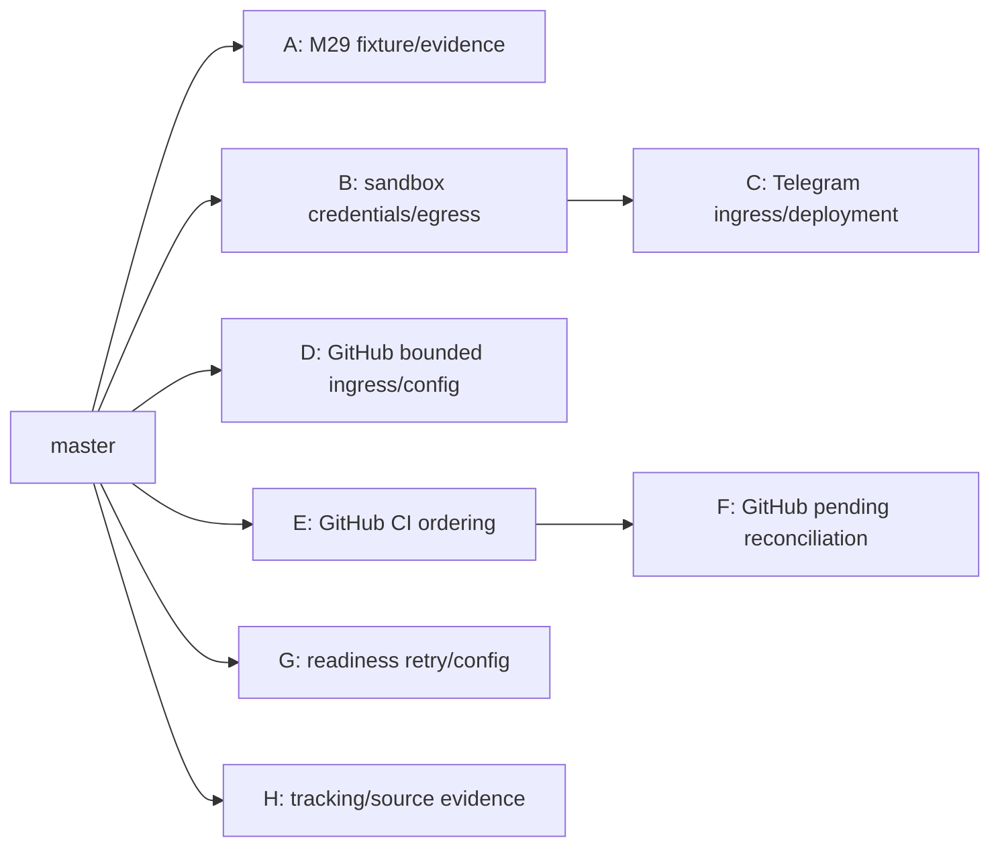

# PR #430 split and reconciliation

## Immutable references and repository state

Source: `77f3a35027776e00b65d3957a7ecfa922c11a18a`. Target: `03d0e8a735912e0aca8365709fe9f6b4eab590ca`. Fresh `git fetch origin master codex/m2-security-hardening` pinned both before extraction. Their merge base equals the target. The original GitHub comparison uses stale base `036bde95c74d517f80c17e6bf32e92d300e3b873`: 244 files, 133 commits, 29,747 additions and 3,656 deletions. The actual outstanding diff against pinned master is 49 files, 3,285 additions and 205 deletions. No original source ref, PR metadata, user checkout, or unrelated worktree is modified.

The original checkout was clean on local master `c71c75c0a59fce966c6a759f7e114e0cc32d113b`. An existing M29 worktree was left untouched. Extraction worktrees live under `/private/tmp/pr430-split/`; the managed detached reference worktree is also preserved. All reconstructions use final source blobs and deliberate shared-file edits, not an interleaved commit cherry-pick. The dependency graph was recorded before extraction branches were created.

## Already merged work

These capabilities are inherited from pinned master and are not duplicated into new PRs:

| Proposed scope | Existing merged history |
| --- | --- |
| M29 mutation evaluation/reports | #433 (`5e5dc399`); only deterministic fixture and LF preservation remain |
| Temporal workflow updates/replay | #437 (`e1ee8628`), #438 (`f6e2a991`) |
| GitHub issue intake and delivery/dashboard sync | #434 (`d3b5531f`), #436 (`470102a6`), #437 |
| Scheduled reviews and dashboard controls | #440 (`582b2601`), #466–#468, #470 |
| Readiness persistence, transports, acknowledgment | #441, #444, #446, #448, #459, #461, #463 |
| Dashboard monitoring/inbox/schedules | Their corresponding feature PRs above |

The three readiness migrations 0053, 0054 and 0055, frozen Temporal histories and published M29 reports are byte-identical between pinned master and source. Their order and provenance are retained. The archived security validation reports retain their original SHA-bound claims; they are not evidence for newly extracted commits. Neither M32 activation nor live-provider gates are marked complete.

## Architecture and dependency graph

C depends on B because its retained real Docker/security contracts cover the integrated execution and ingress boundaries. F depends on E because both change GitHub delivery synchronization. All other changes target master independently. H preserves cross-boundary source-bound evidence as one documentation/preservation utility slice. Documentation for new behavior accompanies each feature PR.

Recommended merge order: **A, B, C, D, E, F, G, H**. B and E must use **merge commits** before their children are retargeted to master. Repository settings allow merge, squash and rebase merges. If a reviewer chooses squash/rebase for a prerequisite, create a new child branch from updated master with only the child patch and a replacement draft PR; retain the published old child, and never force-push it. Do not assume retargeting alone fixes squash ancestry. No merge is authorized by this task.

A and C both add `.gitattributes` from an empty base. Git correctly reports an add/add conflict when combining them. Resolve by retaining all seven original lines (report LF contracts from A, script LF contracts from C). This is a known small integration conflict, not an omitted change. Docker Compose changes are owned by semantic hunks: B changes only credential mounts, C owns loopback/logging/Telegram networks and registration, D adds GitHub variables, G adds readiness webhook variables. D and C both edit API dependencies but separate GitHub body streaming from Telegram guards.

## File and hunk ownership

[Machine-readable manifest](pr430-split-ownership.json) inventories all 244 historical changed paths with source/master blob IDs, marks the 195 paths already present on master, and maps each remaining zero-context diff hunk by line range and SHA-256. Cross-cutting new-file hunks are explicitly divided by contract. New bug-fix/test/documentation paths appear in the final reconciliation inventory.

| Outstanding source path | Owner |
| --- | --- |
| `.dockerignore` | B |
| `.env.example` | C |
| `.gitattributes` | A+C (report attributes / shell attributes) |
| `apps/api/auth.py` | C |
| `apps/api/dependencies.py` | C |
| `apps/api/main.py` | C |
| `apps/api/routes/telegram.py` | C |
| `apps/api/telegram_body.py` | C |
| `apps/api/telegram_security.py` | C |
| `deploy/telegram/nginx.conf` | C |
| `docker-compose.yml` | B+C (credential mounts / remaining ingress and logging hunks) |
| `docs/security/m2-audit.md` | H |
| `docs/security/m2-closeout.md` | H |
| `docs/security/m2-implementation.md` | H |
| `docs/security/m2-operations.md` | H |
| `docs/security/m2-threat-model.md` | H |
| `docs/security/m2-validation.md` | H |
| `docs/status.md` | H |
| `sandbox/container.py` | B |
| `sandbox/legacy_egress.py` | B |
| `sandbox/legacy_security.py` | B |
| `sandbox/native_agent_executor.py` | B |
| `sandbox/provider_bootstrap.py` | B |
| `sandbox/provider_stager.py` | B |
| `sandbox/runner.py` | B |
| `scripts/init_webhook.sh` | C |
| `scripts/m2_preservation.ps1` | H |
| `scripts/up.sh` | C |
| `tests/integration/test_antigravity_provider_auth.py` | B |
| `tests/integration/test_local_infra_config.py` | C |
| `tests/integration/test_m29_mutation_live_e2e.py` | A |
| `tests/integration/test_m2_docker_security.py` | C |
| `tests/integration/test_m2_postgres_rollback.py` | C |
| `tests/integration/test_m2_shell_boundary.py` | B |
| `tests/integration/test_telegram_endpoints.py` | C |
| `tests/unit/test_antigravity_provider_auth.py` | B |
| `tests/unit/test_api_dependencies.py` | C |
| `tests/unit/test_api_telegram_webhook_auth.py` | C |
| `tests/unit/test_docker_sandbox_container.py` | B |
| `tests/unit/test_docker_sandbox_runner.py` | B |
| `tests/unit/test_m2_control_command_redaction.py` | B |
| `tests/unit/test_m2_deployment_contracts.py` | C |
| `tests/unit/test_m2_execution_security.py` | B |
| `tests/unit/test_native_agent_executor.py` | B |
| `tests/unit/test_provider_bootstrap.py` | B |
| `tests/unit/test_provider_diagnostics.py` | B |
| `tests/unit/test_shell_worker.py` | B |
| `tests/unit/test_telegram_security.py` | C |
| `workers/shell_worker.py` | B |

## Confirmed defects and intentional differences

1. D: Compose lacked GitHub secret, owner and issue label; deployment assertions failed before wiring. GitHub authentication called unbounded Request.body; chunked/false Content-Length tests failed before a streaming 1 MiB limit. The new limit is an intentional ingress contract. No public GitHub ingress is enabled.
2. E: A → B → delayed A check_run and check_suite events regressed stored head and CI. Signed HTTP/persistence/snapshot regressions failed before making PR metadata authoritative. Advancing a PR head resets old CI to pending. Check events cannot establish a different head.
3. F: Events arriving before task/run metadata were permanently consumed as ignored/duplicate; both no-task and task-without-run tests failed. Null-task inbound claims now mean pending reconciliation, and redelivery can attach them after metadata persists. This also recovers old ignored null-task claims. **No automatic reconciler/payload store is introduced: operators must redeliver after metadata persists.**
4. G: At-budget expired leases were resent and blocked recovery. Four regressions failed before terminalizing exhausted rows; the API now receives readiness webhook URL/token, empty by default. Unexpired leases and acknowledgment suppression retain precedence.
5. B: Live disposable tests reproduced ConnectionRefusedError for persistent shell startup before the task-private egress proxy listened. Startup now waits inside only its owned container for at most ten seconds, fails closed, and uses existing cleanup. No permission/network relaxation.
6. C: Docker tests use unique task/container identities and expose captured synthetic subprocess diagnostics. This improves fixture isolation and diagnosis; no checks are disabled.

## Verification matrix and evidence

Each branch runs changed-file pre-commit, including Ruff, formatting, size checks, redacted secret scanning, applicable Compose/schema validation, shellcheck and mypy. Repository mypy hooks exclude repositories/, so repository changes require an explicit mypy invocation as well. Tests use the existing repository virtualenv via ignored local tooling directories, never committed environment links. No coverage threshold or hook is bypassed.

| PR | Focused verification |
| --- | --- |
| A | M29 live E2E and published-artifact contracts |
| B | Credential/path/link/ownership/cleanup/privilege unit tests, shell HTTP→Temporal boundary, provider integration, real Docker execution through C |
| C | Telegram auth/policy/body/deployment unit tests, endpoint lifecycle integration, real Nginx DNS/path controls and synthetic PostgreSQL upgrade/restore |
| D | Signed issue intake, streamed exact/over-limit bodies, configuration contract, existing webhook integration |
| E | Unit head selection/reset and signed A→B→delayed A snapshots for check_run/check_suite |
| F | Pending-claim unit tests, no-task/no-worker-run redelivery integration, existing intake/replay/CI suites |
| G | Active/final/expired lease unit tests, recovery send smoke, notification/ack/webhook integration |
| H | Ownership exhaustiveness, JSON/links, source-bound evidence byte comparison, changed-file hooks |

Exact command/outcome records and final equivalence inventory are added after combined validation below. Synthetic tests do not establish live credential refresh, shared-daemon host isolation, external access safety or real deployment rollback. No real provider, Telegram or webhook credentials are used.

## Remaining operational gates

Keep all drafts unmerged. Real-provider authentication and refresh, root-broker staging on Linux, deployment activation, independent external ingress exposure validation and live backup/rollback remain separate explicit gates. Protect PR #430 until the split is reviewed, merged and reconciled; only then close it as superseded with links, retaining the original branch until combined deployment validation is accepted.
